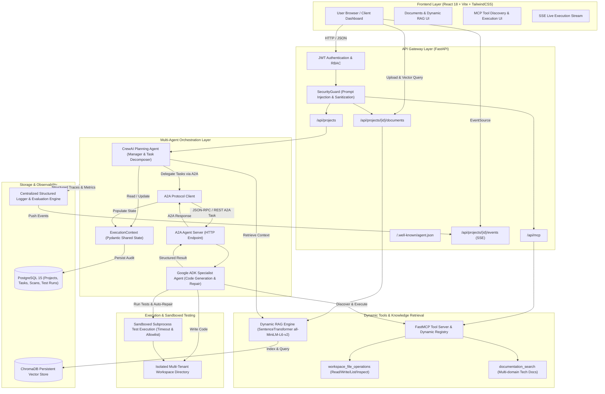
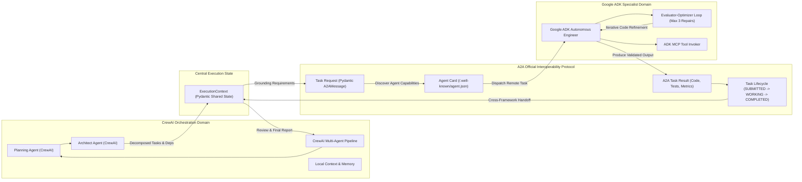
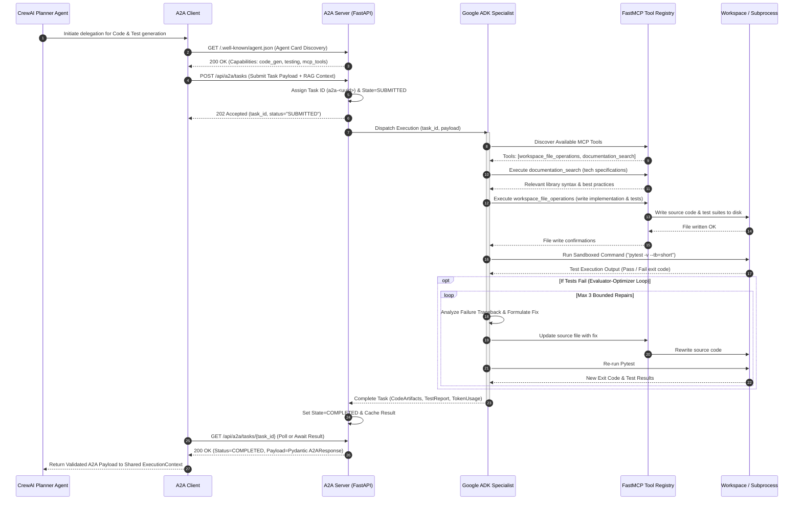
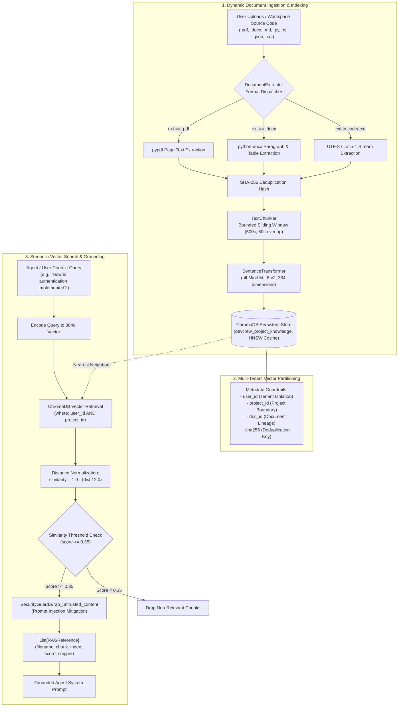
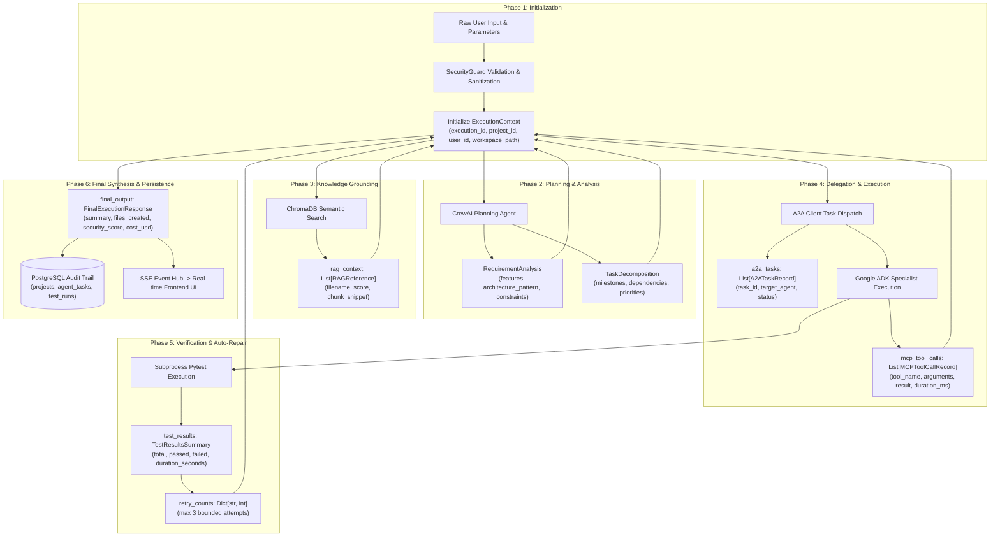
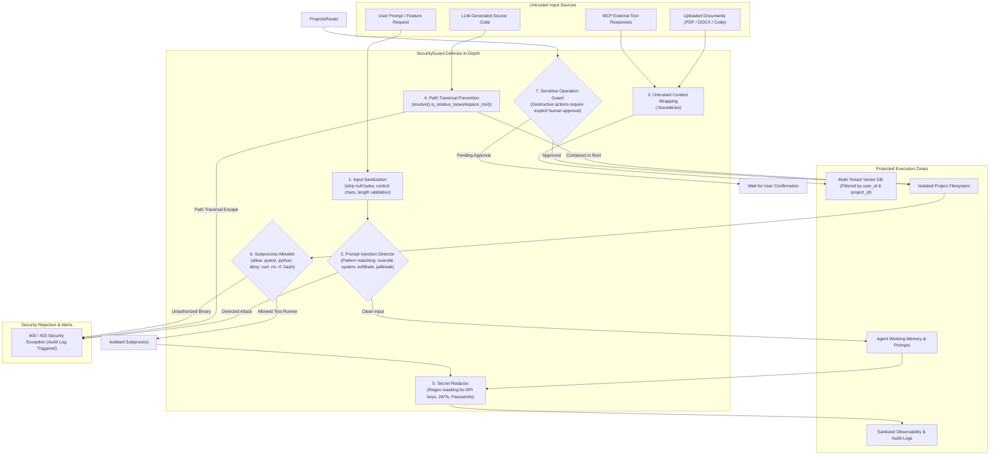

# DevCrew System Architecture & Engineering Specification

## 1. Executive Summary & Overview

**DevCrew** is a multi-agent AI platform for autonomous software engineering, testing, and DevOps orchestration. The system coordinates **CrewAI** and **Google ADK** through the official **A2A (Agent-to-Agent) protocol** to accept natural language user requirements, dynamically ground execution via **ChromaDB-backed RAG**, dynamically discover and invoke **FastMCP tools**, synthesize full-stack source code, and execute sandboxed test suites with an **Evaluator-Optimizer auto-repair loop**.

### Core Tenets
1. **Framework Strictness**: Strictly **CrewAI** (Planning & Orchestration) + **Google ADK** (Specialist Engineering & Tool Execution). Zero LangGraph, AutoGen, or LangChain agents.
2. **Real A2A Protocol**: Inter-framework communication occurs via standards-compliant Agent Cards (`/.well-known/agent.json`), asynchronous task creation, status tracking, and structured Pydantic payloads.
3. **Zero-Hardcoding Policy**: Real user inputs, dynamically uploaded documents (PDF, DOCX, Code, Markdown), live vector search (`all-MiniLM-L6-v2`), live FastMCP tool execution, and live LLM model generation.
4. **Defense-in-Depth Security**: Prompt injection detection, path traversal confinement, untrusted content boundaries, secret redaction, and subprocess command allowlists.

---

## 2. Technology Stack

| Layer | Technologies | Role |
| :--- | :--- | :--- |
| **Frontend UI** | React 18, TypeScript, Vite, Tailwind CSS, Lucide Icons | Responsive dashboard, SSE execution stream, document uploads, vector query tester, MCP tool catalog |
| **API Gateway** | FastAPI, Uvicorn, Pydantic v2, SSE (EventSource) | Async REST API, JWT auth, RBAC, input sanitization, security guardrails |
| **Orchestration** | CrewAI | Requirement decomposition, architectural planning, task dependency management |
| **Specialist Agent** | Google ADK (Autonomous Development Kit) | Code synthesis, file creation, test execution, Evaluator-Optimizer auto-repair loop |
| **A2A Protocol** | Official A2A Specification, JSON-RPC / REST | Agent Card discovery, asynchronous task lifecycle, cross-framework message passing |
| **MCP Integration** | FastMCP, Python introspection, dynamic schema generation | Live tool discovery (`workspace_file_operations`, `documentation_search`), argument validation |
| **Vector DB & RAG** | ChromaDB (HNSW cosine space), SentenceTransformers (`all-MiniLM-L6-v2`) | Multi-format parsing (PDF, DOCX, Code, MD), dense 384d semantic retrieval, multi-tenant isolation |
| **Persistence** | PostgreSQL 15, SQLAlchemy (asyncpg), Alembic | Relational models for users, projects, tasks, messages, security scans, and test runs |
| **Sandboxing** | Python `asyncio.subprocess`, path jail, command allowlists | Isolated execution of `pytest` within multi-tenant workspace folders |
| **Observability** | `structlog`, Langfuse Tracing SDK, OpenTelemetry | Correlated execution tracing, latency breakdown, token counting, cost evaluation |
| **Containers** | Docker, Docker Compose | Production multi-container topology (`frontend`, `backend`, `db`) |

---

## 3. High-Level System Architecture



---

## 4. Multi-Agent Framework Interoperability (CrewAI + Google ADK)

The system implements a clean separation of concerns between high-level orchestration and low-level engineering execution.

### Agent Responsibilities
- **CrewAI Planning Agent**: Receives raw user requirements, parses scope, executes architectural planning, performs task decomposition with milestone dependencies, and manages the execution lifecycle.
- **Google ADK Specialist Agent**: Receives assigned engineering tasks via the A2A protocol. Dynamically selects MCP tools to retrieve technical documentation, generates modular code and test suites, writes files to the workspace, executes pytest, and autonomously fixes failing tests.
- **Reviewer / Synthesizer**: Audits final code artifacts, validates test execution reports, runs security scans, calculates metrics, and produces the final structured Pydantic response.



---

## 5. Official A2A Protocol Communication Flow

Communication between CrewAI and Google ADK strictly follows the A2A specification:

1. **Discovery**: The client discovers capabilities through `GET /.well-known/agent.json`.
2. **Task Creation**: Client creates a task with a unique task ID, payload, and contextual parameters.
3. **Execution**: Server dispatches task to the Google ADK runner.
4. **Response**: Server returns validated Pydantic models containing generated code, test reports, and execution metrics.



---

## 6. Dynamic RAG Architecture

The Dynamic RAG pipeline guarantees multi-tenant isolation, real document parsing, and dynamic vector indexing:

- **Supported Formats**: PDF (`pypdf`), DOCX (`python-docx`), Code (`.py`, `.ts`, `.js`, `.sql`), Markdown (`.md`), Plain Text (`.txt`).
- **Embedding Model**: `all-MiniLM-L6-v2` generating 384-dimensional dense vectors.
- **Normalization Formula**:
  $$\text{similarity} = \max\left(0.0, \min\left(1.0, 1.0 - \frac{\text{distance}}{2.0}\right)\right)$$
- **Multi-Tenant Filter**:
  ```python
  where = {"$and": [{"user_id": str(user_id)}, {"project_id": str(project_id)}]}
  ```



---

## 7. FastMCP Tool Discovery and Execution Architecture

DevCrew integrates genuine external MCP tools through FastMCP:

1. **`workspace_file_operations`**: Controlled file read, write, list, and metadata inspection within the project workspace jail.
2. **`documentation_search`**: Technical documentation retrieval across Python, FastAPI, React, and container security specifications.

```mermaid
flowchart TD
    subgraph AgentClient["Agent Calling Layer"]
        ADKAgent["Google ADK Autonomous Agent"]
        CrewAgent["CrewAI Tool Invoker"]
        MCPClient["MCPClient (Singleton)"]
    end

    subgraph Validation["Security & Schema Validation"]
        SchemaValidator["Input Schema Validator (Type & Required Field Check)"]
        PathSanitizer["SecurityGuard.validate_safe_path (Path Traversal Guard)"]
    end

    subgraph MCPServer["FastMCP Tool Server & Registry"]
        ToolDiscovery["Dynamic Discovery Engine (inspect.signature -> JSON Schema)"]
        ToolRegistry["Tool Registry (Dynamic Mapping)"]
    end

    subgraph RealTools["Functional External MCP Tools"]
        subgraph ToolFS["1. workspace_file_operations"]
            ReadAction["read_file"]
            WriteAction["write_file"]
            ListAction["list_files"]
            InfoAction["file_info"]
        end
        
        subgraph ToolDocs["2. documentation_search"]
            PythonDocs["Python Standard & Asyncio Specs"]
            FastAPIDocs["FastAPI & Pydantic Patterns"]
            ReactDocs["React & Vite Guidelines"]
            SecurityDocs["OWASP & Container Security"]
        end
    end

    subgraph FileSystem["Workspace Storage"]
        TargetWorkspace["Project Workspace Directory (/workspaces/{project_id})"]
    end

    ADKAgent -->|Request Available Tools| MCPClient
    CrewAgent -->|Request Available Tools| MCPClient
    MCPClient -->|Introspect| ToolDiscovery
    ToolDiscovery --> ToolRegistry
    ToolRegistry -->> MCPClient: List of Tool Schemas & Descriptions

    ADKAgent -->|Invoke Tool(name, args)| MCPClient
    MCPClient --> SchemaValidator
    SchemaValidator --> PathSanitizer

    PathSanitizer -->|workspace_file_operations| ToolFS
    PathSanitizer -->|documentation_search| ToolDocs

    ToolFS -->|Confined I/O| TargetWorkspace
    ToolDocs -->|Synthesize & Return Docs| MCPClient

    MCPClient -->|Log Telemetry duration_ms| AuditLog["Structured structlog Logger"]
    MCPClient -->> ADKAgent: Validated Pydantic Tool Result
```

---

## 8. Shared State Management & Context Passing

All execution state is managed via the Pydantic `ExecutionContext` model, serialized to PostgreSQL, and streamed via SSE:



---

## 9. Security & Guardrails Architecture

The platform implements defense-in-depth security using `SecurityGuard`:



---

## 10. End-to-End Execution Workflow

```mermaid
sequenceDiagram
    autonumber
    actor User as Developer / User
    participant Frontend as DevCrew Web Dashboard
    participant API as FastAPI Backend Gateway
    participant CrewAI as CrewAI Planning Engine
    participant RAG as Dynamic RAG Service
    participant A2A as A2A Interoperability Hub
    participant ADK as Google ADK Autonomous Agent
    participant MCP as FastMCP Tool Registry
    participant Sandbox as Isolated Workspace Subprocess
    participant DB as PostgreSQL Database

    User->>Frontend: Submit Requirement ("Build Task Manager App")
    Frontend->>API: POST /api/projects/ (Title, Description, Requirement)
    API->>DB: INSERT into projects (status="CREATED")
    API-->>Frontend: 201 Created (project_id)

    User->>Frontend: Click "Run Autonomous Pipeline"
    Frontend->>API: POST /api/projects/{id}/run
    API->>DB: UPDATE projects (status="ANALYZING")
    API-->>Frontend: 202 Accepted (Pipeline Started)
    Frontend->>API: GET /api/projects/{id}/events (Connect SSE Stream)

    rect rgb(20, 30, 48)
        note over CrewAI, RAG: Planning & Knowledge Grounding
        API->>CrewAI: Start Multi-Agent Planning
        CrewAI->>CrewAI: Analyze Requirements & Decompose Tasks
        CrewAI->>RAG: Retrieve Project Documents & Code Context
        RAG-->>CrewAI: Return Relevant Chunks (Cosine Similarity >= 0.35)
    end

    rect rgb(28, 40, 60)
        note over CrewAI, ADK: Cross-Framework A2A Delegation
        CrewAI->>A2A: Dispatch A2A Task Request (Task Specification + RAG Context)
        A2A->>ADK: Invoke Google ADK Specialist Agent (task_id)
    end

    rect rgb(20, 45, 45)
        note over ADK, MCP: Code Synthesis via FastMCP Tools
        ADK->>MCP: Query documentation_search (Python/FastAPI syntax)
        MCP-->>ADK: Best practices & library specifications
        ADK->>MCP: Call workspace_file_operations (write models, routers, tests)
        MCP->>Sandbox: Write files to isolated workspace
        Sandbox-->>MCP: Files Written OK
    end

    rect rgb(45, 30, 45)
        note over ADK, Sandbox: Sandboxed Pytest & Auto-Repair Loop
        ADK->>Sandbox: Execute "pytest -v --tb=short"
        Sandbox-->>ADK: Test Output & Exit Code
        opt On Test Failure (Max 3 Attempts)
            loop Auto-Repair Loop
                ADK->>ADK: Diagnose stack trace & generate fix
                ADK->>MCP: Update source file
                ADK->>Sandbox: Re-run Pytest
                Sandbox-->>ADK: Updated Exit Code (0 = Success)
            end
        end
    end

    ADK-->>A2A: Return Final Code Artifacts & Test Summary
    A2A-->>CrewAI: Return A2A Task Response
    CrewAI->>CrewAI: Review Code Quality & Security Compliance
    CrewAI-->>API: Final Structured Output (Pydantic FinalExecutionResponse)

    API->>DB: UPDATE projects (status="COMPLETED", completed_at=now())
    API->>Frontend: Push SSE Event (event="pipeline_completed", status="COMPLETED")
    Frontend-->>User: Display Interactive Summary, Files, Tests & Download Button
```



---

## 11. Production Deployment Topology

```mermaid
flowchart TD
    subgraph Internet["Public Internet"]
        Client["Developer / Web Browser"]
    end

    subgraph Host["Production Docker Host / Cloud VM"]
        subgraph Ingress["Ingress / Reverse Proxy"]
            ReverseProxy["Nginx / Cloud Load Balancer\n(TLS Termination, Port 80/443)"]
        end

        subgraph DockerNetwork["Internal Bridge Network: devcrew-net"]
            subgraph FrontendContainer["devcrew-frontend (Container)"]
                FrontendApp["Vite Production Server / Nginx\nPort 5173\nHealth: /"]
            end

            subgraph BackendContainer["devcrew-backend (Container)"]
                FastAPIApp["Uvicorn ASGI Server (Python 3.11)\nPort 8000\nHealth: /health"]
                A2AEndpoint["A2A Protocol Server\n/.well-known/agent.json"]
                MCPServer["FastMCP Tool Server\n/api/mcp"]
                RAGEngine["Dynamic RAG Engine\nSentenceTransformers"]
            end

            subgraph DatabaseContainer["devcrew-db (Container)"]
                PostgresDB["PostgreSQL 15 (Alpine)\nPort 5432\nHealth: pg_isready"]
            end
        end

        subgraph PersistentVolumes["Host Persistent Storage"]
            PGData[("postgres_data\n(Relational Database State)")]
            ChromaData[("chroma_db\n(Vector Embeddings & HNSW Indices)")]
            WorkspacesData[("workspaces\n(Isolated Project Files & Code)")]
        end
    end

    subgraph ExternalCloud["External Cloud Services"]
        LLMProvider["LLM API Providers\n(OpenRouter / Groq / OpenAI)"]
        LangfuseCloud["Langfuse / OTel Observability\n(Traces, Spans & Cost Metrics)"]
    end

    Client -->|HTTPS :443| ReverseProxy
    ReverseProxy -->|Proxy UI :5173| FrontendApp
    ReverseProxy -->|Proxy API :8000| FastAPIApp

    FrontendApp -.->|API Calls & SSE Stream| FastAPIApp

    FastAPIApp -->|Async SQL (asyncpg)| PostgresDB
    FastAPIApp -->|Confined File I/O| WorkspacesData
    FastAPIApp -->|Dense Vector Read/Write| ChromaData

    PostgresDB --> PGData

    FastAPIApp -->|Outbound HTTPS (Bearer Auth)| LLMProvider
    FastAPIApp -->|Telemetry Traces & Spans| LangfuseCloud
```

